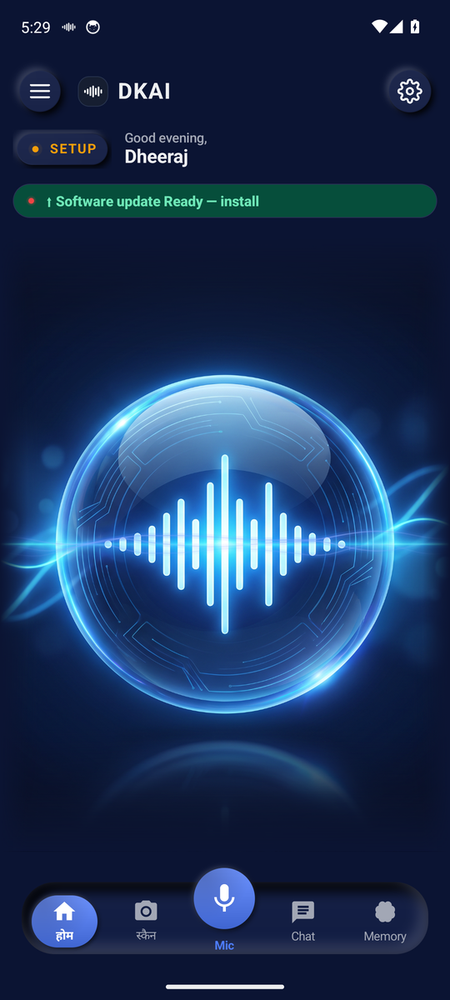
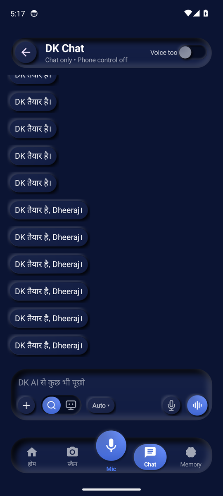
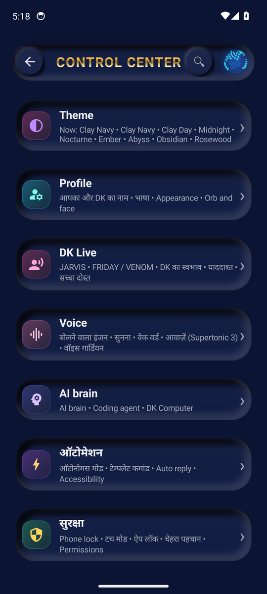
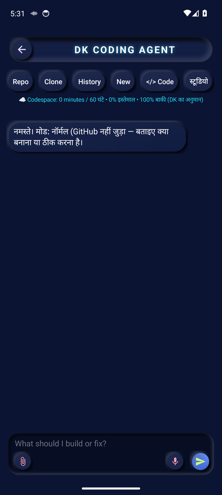
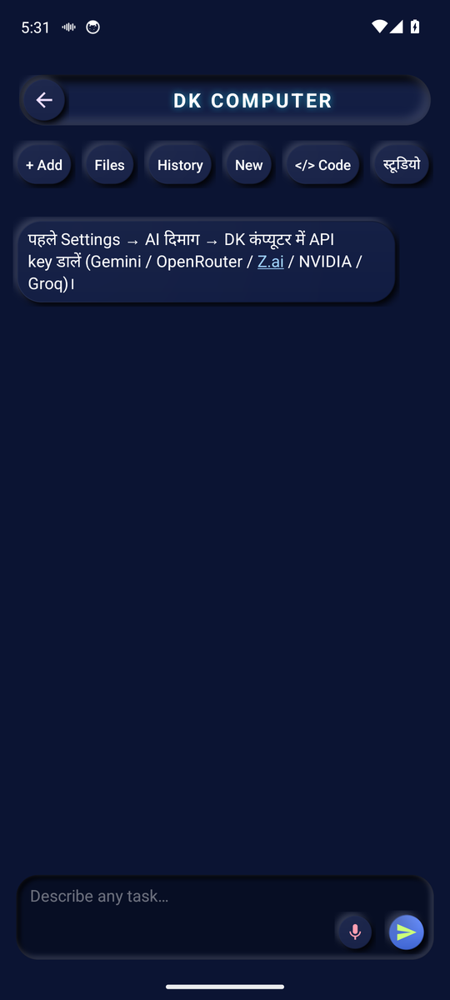

<div align="center">

# DK AI

### Your voice, your phone, your AI

**An Android AI assistant that listens, understands, replies and runs your whole phone for you.**

[](../../releases/latest)
[](../../actions/workflows/check.yml)


[](LICENSE)

[Screenshots](#screenshots) · [Features](#features) · [Download](#download-and-install) · [Privacy](#security-and-privacy) · [License](#license)

</div>

---

## Screenshots

<div align="center">

| Home | Chat | Settings | Coding Agent | DK Computer |
|:---:|:---:|:---:|:---:|:---:|
|  |  |  |  |  |

</div>

---

## Features

### DK Live (voice)
- Real-time voice conversation on Gemini Live, with interruption support
- Live transcript on screen
- Live camera (Vision): DK sees what you show it
- Speaks Hindi, Hinglish, English, Bhojpuri and Marathi
- Human-like voice with emotions (soft, happy, sad, angry, singing)
- Offline DK voice fallback
- On-device voice recognition ("only my voice")
- Wake word
- Honest replies: DK confirms a task actually finished before saying "done"

### DK Chat
- Streaming text chat
- Web search with sources
- Research and deep research reports
- Files, photos and a "deep thinking" mode
- Voice input inside chat

### Home and UI
- Home with ORB / 3D character (11 artworks, default DK wave orb)
- 5-tab bottom bar: Home, Scan, Mic, Chat, Memory
- Side menu
- Soft 3D clay design with 8 themes, dark and light modes
- DK Island (running tasks, calls and notifications on the notch)
- Live wallpaper (sun by day, moon by night)

### Phone Control
- Open apps and change settings (torch, volume, brightness, Wi-Fi)
- Send messages and make calls, caller name announcement
- Play YouTube and media
- Maps, navigation and nearby places
- On-screen actions: read, tap, type, scroll, swipe
- Multiple tasks in one command, in a smart order

### Memory and Brain
- Memory ("remember this"), with a Memory screen
- DK Mind: learns from daily conversations, stored on the phone
- Offline commands (time, battery, math, alarms)
- Backup and restore (Google Drive)
- Personality settings

### DK Lens and DK Teacher
- DK Lens: scan anything with the camera
- DK Teacher: step-by-step explanations with drawing on a board

### Coding Agent
- 7-agent team: Manager, Git, Planner, Coder, Reviewer, Tester, Debugger
- GitHub mode (feature branch, PR, tests) and Normal mode (code with file names)
- Merge only with your approval
- API fallback across providers

### DK Computer and Studio
- Browser automation
- Create PDF and office files
- Long multi-step tasks
- Image generation
- Email (read, send, delete with confirmation)
- DKAI Studio / Forge: build websites and apps with live preview

### Safety and Automation
- Emergency SOS (10-second countdown)
- Driving mode
- Event triggers (charger, Wi-Fi, battery saver)
- Auto reply and WhatsApp group reports
- Face recognition
- App lock, God mode and Stealth mode
- Find my phone
- YouTube channel stats
- Termux automation
- FRIDAY / VENOM modes
- Story writer

### AI Providers
- Google Gemini, Groq, OpenRouter, Custom (OpenAI-compatible)
- Separate key and model for Live, Chat, Coding Agent and DK Computer
- Automatic switch to another free model when a limit is reached

### Updates
- In-app updates (software updates and security patches)
- Stable and Beta channels

---

## Download and Install

1. Download the latest APK from [Releases](../../releases/latest)
2. Allow "Install unknown apps" and install the APK
3. Open the app and add any free API key in Settings → AI Brain → Quick setup
4. Grant Accessibility and Microphone permissions, then tap the mic to start talking

> Requires Android 8.0 (API 26) or newer. Voice recognition works on 64-bit (arm64) phones only.

---

## Security and Privacy

- API keys encrypted on the phone (AES-256-GCM + Android KeyStore)
- HTTPS only
- No secrets in logs
- Safe auto reply (skips groups, OTPs, passwords, banking)
- SOS only on a clear command, with a cancel window
- SHA-256 check on every model and update download
- Instructions found on screens, messages or web pages are never treated as commands
- Confirmation card for payments, deletes and sending
- Strict voice unlock
- Crash reports are opt-in

Full details: [Privacy page (docs/PRIVACY.md)](docs/PRIVACY.md)

---

## Quality

- 2,400+ unit tests run on every PR, along with a debug build
- Protected `main` branch, changes only through PRs
- Rules: [`AGENTS.md`](AGENTS.md) · Releases: [`docs/RELEASE.md`](docs/RELEASE.md) · History: [`CHANGELOG.md`](CHANGELOG.md)

<details>
<summary><b>Build (owner and authorized people only)</b></summary>

```bash
# Requires JDK 17 + Android SDK 34
./gradlew :app:testDebugUnitTest      # all tests
./gradlew :app:assembleDebug          # debug APK
```
</details>

---

## License

**© 2025–2026 Dheeraj Kumar Singh. All Rights Reserved.**

This project is **not open source**. The repository being public does not give anyone the right to use it.
Copying, modifying, selling, sharing, rebranding or reusing this app, its code, design, the name "DK" or any part of it **without written permission from the owner is not allowed.**
You may only view the code and install the official APK from Releases on your own phone for personal use. Full terms: [`LICENSE`](LICENSE)

For permission or partnership: [@rolexdkscreation-max](https://github.com/rolexdkscreation-max)

<div align="center">

---

**DK AI** · Made with love in India

</div>
