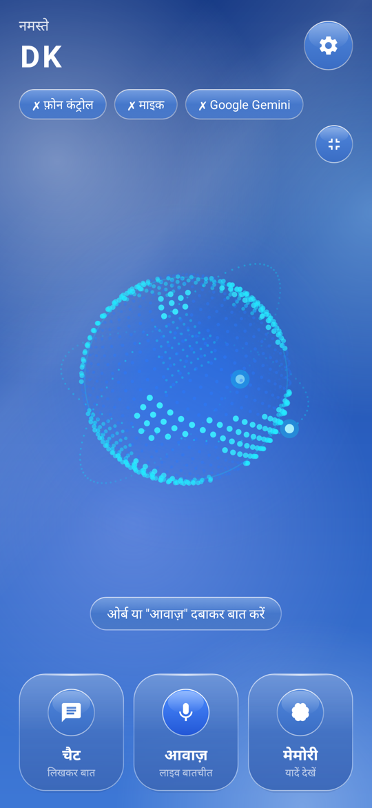
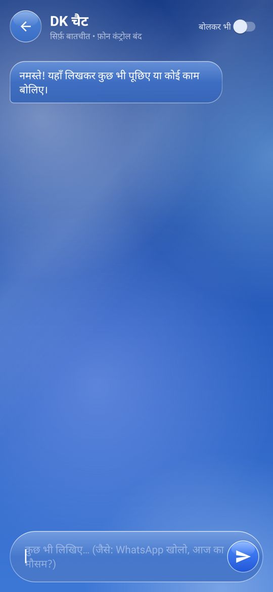
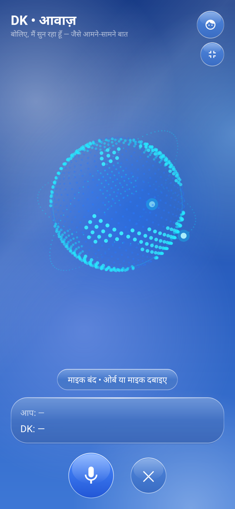
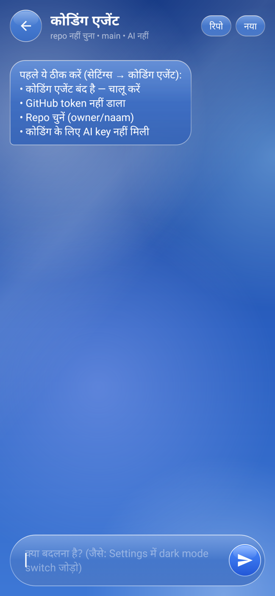
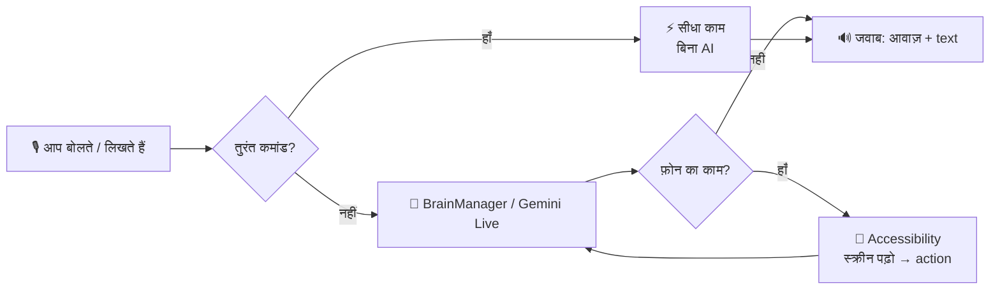

<div align="center">

# DK AI

### आपकी आवाज़, आपका फ़ोन, आपका AI

**एक Android AI असिस्टेंट जो सुनता है, समझता है, जवाब देता है और पूरा फ़ोन खुद चलाता है।**

[](../../releases/latest)
[](../../actions/workflows/check.yml)


[](LICENSE)

[डाउनलोड](#-डाउनलोड-और-इंस्टॉल) · [फ़ीचर](#-मुख्य-फ़ीचर) · [स्क्रीनशॉट](#-एक-झलक) · [सुरक्षा](#-सुरक्षा-और-प्राइवेसी) · [लाइसेंस](#-लाइसेंस)

</div>

---

## ✨ एक झलक

<div align="center">

| होम | चैट | आवाज़ | कोडिंग एजेंट |
|:---:|:---:|:---:|:---:|
|  |  |  |  |

</div>

DK एक ऐसा निजी AI साथी है जो **हिंदी, Hinglish, English, भोजपुरी और मराठी** में इंसान जैसी बातचीत करता है।
आप जो कहें वह फ़ोन पर तुरंत हो जाता है: ऐप खोलना, मैसेज भेजना, कॉल उठाना, रास्ता बताना, गाना चलाना। यहाँ तक कि DK आपके लिए कोड लिखकर GitHub पर PR भी बना देता है।

---

## 🚀 मुख्य फ़ीचर

### 🎙️ DK लाइव: आवाज़ से आवाज़
- **Gemini Live** पर सीधी स्ट्रीम: बोलना खत्म होते ही जवाब, बीच में टोकें तो DK उसी पल रुक जाता है
- बोलते-बोलते शब्द स्क्रीन पर दिखते हैं; DK जितना बोला, उतना ही लिखा दिखता है
- कनेक्शन टूटे तो अपने-आप दोबारा जुड़ता है, बातचीत याद रहती है
- **लाइव कैमरा (Vision):** जो दिखाएँ, DK उसे देखकर समझाता है
- **सच्चा DK:** काम हुआ या नहीं, फ़ोन दोबारा जाँचता है। पक्का न हो तो DK "हो गया" नहीं कहता, सच बताता है। फ़ोन पर कोई कॉल न हो तो "कॉल आ रहा है" भी नहीं कहता।
- **सिर्फ़ मेरी आवाज़:** फ़ोन पर ही आवाज़-पहचान (ONNX), किसी सर्वर पर नहीं

### 🧭 नीचे की 5-टैब पट्टी
- **होम • स्कैन • माइक • चैट • मेमोरी**: एक टैप में DK लेंस, DK लाइव, पूरी चैट और यादें
- कीबोर्ड खुलने पर पट्टी अपने-आप छुप जाती है। Settings › दिखावट में इसे छुपा भी सकते हैं।

### 💬 DK चैट
- लिखकर बात करें, जवाब लिखे जाते समय ही दिखता है (streaming)
- ताज़ा जानकारी के लिए वेब सर्च, जवाब के नीचे **स्रोत (sources)**
- "सर्च करो / रिसर्च करो / डीप रिसर्च करो" पर कई स्रोतों से पूरी रिपोर्ट
- फ़ाइलें, फ़ोटो और कठिन सवालों के लिए "गहरी सोच" मोड

### 📱 पूरा फ़ोन कंट्रोल
| काम | उदाहरण |
|---|---|
| ऐप और सेटिंग | "WhatsApp खोलो", "टॉर्च जलाओ", "आवाज़ 50 करो", "ब्राइटनेस कम" |
| मैसेज और कॉल | "माँ को मैसेज भेजो", "पापा को कॉल करो", कॉल आने पर पहले नाम बताना |
| YouTube और मीडिया | "YouTube पर ___ चलाओ": बिना AI के लगभग 1 सेकंड में |
| मैप | रास्ता, नेविगेशन, पास की जगहें, दो जगहों की दूरी |
| स्क्रीन पर काम | स्क्रीन पढ़कर खुद click, type, scroll, swipe |

### 🧠 DK का अपना दिमाग
- **मेमोरी:** "याद रखो…" कहें तो DK याद रखता है। मेमोरी स्क्रीन से देखें या हटाएँ
- **DK Mind:** रोज़ की बातचीत से सीखता है, सीखा हुआ फ़ोन पर ही रखता है
- **ऑफ़लाइन:** समय, बैटरी, हिसाब, अलार्म जैसे काम बिना इंटरनेट के
- बैकअप और रीस्टोर (Google Drive)

### 👨‍💻 कोडिंग एजेंट: 7 एजेंट की टीम
```
मैनेजर → गिट → प्लानर → कोडर → रिव्यूअर → टेस्टर → डिबगर
```
- हर काम नई `feature/…` branch पर होता है, `main` पर कभी सीधे नहीं
- Push से पहले नाम-जाँच, syntax-जाँच और test होते हैं; fail होने पर पहले असली वजह (root cause) ढूँढी जाती है
- **Merge सिर्फ़ आपकी मंज़ूरी से**, फिर नई APK अपने-आप बनती है
- एक API की limit खत्म हो तो अगली पर: Gemini → Groq → OpenRouter → Z.ai → NVIDIA

### 🖥️ DK कंप्यूटर और Studio
- **DK कंप्यूटर:** ब्राउज़र चलाना, PDF और ऑफ़िस फ़ाइलें बनाना, लंबे काम कदम-दर-कदम
- **DKAI Studio / Forge:** वेबसाइट और ऐप का कोड बनाकर तुरंत Preview

### 🛡️ सुरक्षा और ऑटोमेशन (सब मुफ़्त, शुरू में बंद, ज़रूरत पर चालू करें)
| सुविधा | Settings में कहाँ | क्या करती है |
|---|---|---|
| 🚨 **इमरजेंसी SOS** | सुरक्षा → टच मोड | "SOS भेजो" कहें तो **10 सेकंड की उल्टी गिनती** होती है ("SOS रोको" से रद्द)। फिर 5 नंबरों पर SMS और WhatsApp से लोकेशन जाती है, और नंबरों पर कॉल होती है |
| 🚗 **ड्राइविंग मोड** | ऑटोमेशन → Accessibility | गाड़ी चलाते समय कॉल रोकता है, कॉल करने वाले को अपने-आप SMS जाता है |
| ⚡ **इवेंट ट्रिगर** | ऑटोमेशन → Accessibility | चार्जर, Wi-Fi या बैटरी सेवर के बदलने पर अपने-आप काम |
| 🖼️ **इमेज बनाना** | दिमाग और आवाज़ → DK कंप्यूटर | मुफ़्त API (Pollinations, AI Horde, Hugging Face) या अपनी API से |
| 📺 **YouTube चैनल जाँच** | सोशल और कहानी → सोशल रिव्यू | subscribers, views, नए वीडियो और comments (सिर्फ़ पढ़ना) |
| 🧰 **Termux ऑटोमेशन** | दिमाग और आवाज़ → कोडिंग एजेंट | Termux में कमांड और लोकल सर्वर |
| 🙂 **चेहरा पहचान** | सुरक्षा → चेहरा पहचान | आपका और 20 तक जान-पहचान वालों का चेहरा सेव; "यह कौन है?" पर कैमरे से पहचान (मॉडल इंटरनेट से) |
| 🕶️ **God / Stealth मोड** | सुरक्षा → टच मोड | God: सबसे सख़्त, PIN से बंद नहीं। Stealth: बिना आवाज़ चुपके से फ़ोटो + लोकेशन |
| ✉️ **ईमेल** | दिमाग और आवाज़ → DK कंप्यूटर | Gmail/Outlook/Yahoo/Zoho पढ़ना, भेजना, हटाना (app password; भेजने/हटाने से पहले पूछता है) |
| 📊 **WhatsApp ग्रुप रिपोर्ट** | ऑटोमेशन → ऑटो रिप्लाई | अपना फ़ॉर्मेट सेव करें, बोलकर भरें, ग्रुप में भेजें |
| 🦸 **FRIDAY / VENOM** | आवाज़ → FRIDAY / VENOM मोड | अलग अंदाज़ और आवाज़ वाला DK |

### 🎨 दिखावट और अनुभव
- **साफ़ UI:** ठोस कार्ड, रंगीन icons, डार्क और लाइट थीम (लाइट में भी बिल्कुल वही design, सिर्फ़ पृष्ठभूमि, कार्ड और लिखावट उजले)
- **"सोच रहा हूँ…" एनीमेशन:** दिखावट में चुना टाइपिंग एनीमेशन चैट के बुलबुले और ऊपर के THINKING पर भी
- 7 तरह के 3D डॉट ओर्ब, "अपना चेहरा दिखाओ" पर DK का चेहरा
- **DK Island:** नॉच पर चलता काम, कॉल और बिना देखा नोटिफ़िकेशन
- 30 से ज़्यादा नेचुरल आवाज़ें (Google और Gemini)
- ऐप के अंदर से अपडेट: सॉफ़्टवेयर अपडेट और सिक्योरिटी पैच अलग, स्क्रीन बंद होने पर भी डाउनलोड

### 🔌 AI कंपनियाँ
**Google Gemini · Groq · OpenRouter · Custom (OpenAI-compatible)**
हर हिस्से (लाइव, चैट, कोडिंग, कंप्यूटर) की अपनी key और अपना मॉडल चुन सकते हैं। Limit खत्म हो तो उसी key के दूसरे फ्री मॉडल पर अपने-आप चला जाता है।

---

## 📥 डाउनलोड और इंस्टॉल

1. [**Releases**](../../releases/latest) से सबसे नई APK फ़ाइल डाउनलोड करें
2. फ़ोन में "Unknown apps install" की इजाज़त दें और APK इंस्टॉल करें
3. ऐप खोलें और **सेटिंग्स → AI दिमाग → तुरंत सेटअप** में कोई भी फ्री key डालें (DK खुद पहचान लेता है कि key किस कंपनी की है)
4. **Accessibility** और **माइक** की इजाज़त दें, फिर "आवाज़" दबाकर बात शुरू करें

> **ज़रूरत:** Android 8.0 (API 26) या नया। आवाज़-पहचान सिर्फ़ 64-bit (arm64) फ़ोन पर, बाकी सब हर फ़ोन पर।
> आगे के अपडेट ऐप के अंदर **सेटिंग्स → अपडेट** से आते हैं।

---

## 🔐 सुरक्षा और प्राइवेसी

- 🔑 **API keys फ़ोन में ताले में:** AES-256-GCM + Android KeyStore। Google backup या फ़ोन-ट्रांसफ़र में keys नहीं जातीं
- 🌐 **सिर्फ़ HTTPS:** बाहर का हर कनेक्शन encrypted है, Gemini key URL की जगह header में जाती है
- 🧾 **Log में राज़ नहीं:** डिबग लॉग में key और बातचीत छिपा दी जाती हैं; release APK में Logcat बंद रहता है
- 💬 **Auto Reply में समझदारी:** group, OTP, पासवर्ड, बैंक या पैसे वाली बातों पर DK खुद जवाब नहीं देता
- 🚨 **SOS गलती से नहीं:** SOS सिर्फ़ साफ़ आदेश पर चलता है, "SOS क्या है?" जैसे सवाल पर नहीं, और भेजने से पहले 10 सेकंड रद्द करने का समय मिलता है
- 📦 **मॉडल डाउनलोड की जाँच:** हर फ़ाइल का SHA-256 मिलाया जाता है, न मिले तो फ़ाइल मिटा दी जाती है
- ✍️ **हर APK एक ही key से sign:** Android खुद अपडेट की पहचान जाँचता है
- 🧭 **बाहर की लिखावट = हुक्म नहीं:** स्क्रीन / मैसेज / वेब पेज में लिखे निर्देश DK नहीं मानता; भुगतान, डिलीट और बिना कहे भेजना = ऐप का अपना "हाँ / ना" कार्ड
- 🔓 **आवाज़ से अनलॉक सख़्त:** पहले "अनलॉक करो" कहना, ताज़ा आवाज़ Voice Guardian से मिलनी, पुरानी रिकॉर्डिंग पर मना, 3 गलती = 30 मिनट रोक
- 🐞 **क्रैश रिपोर्ट आपकी मर्ज़ी से:** शुरू से बंद, अपने-आप कुछ नहीं जाता
- 🚦 **स्टेबल / बीटा अपडेट:** आप चुनें; हर अपडेट का SHA-256 मिलाया जाता है

पूरा ब्योरा कि कौन-सा डेटा कहाँ रहता है और कब किसे जाता है: **[निजता पेज (docs/PRIVACY.md)](docs/PRIVACY.md)**

---

## 🏗️ यह कैसे काम करता है



| परत | मुख्य हिस्से |
|---|---|
| सुनना | `Ear`, `VoiceListener`, `Transcriber`, `GeminiLiveMic` |
| सोचना | `AgentRunner`, `BrainManager`, `LocalRouter`, `DkMind` |
| करना | `DKAccessibilityService`, `QuickCommands`, `DeviceActions`, `CallManager` |
| बोलना | `Speaker`, `GeminiTts`, `GeminiLivePlayer` |
| नेटवर्क | `NetFix` (IPv4-पहले, DNS-over-HTTPS fallback), `Retry` |
| भरोसा | `SecretPrefs`, `DKApp` (crash से बचाव), `CrashLog`, `DKBug` Inspector |

---

## 🧪 गुणवत्ता

- **2,400+ unit tests** (JUnit + Robolectric): हर PR पर सारे tests और debug build चलते हैं
- हर merge पर release build और Android emulator पर ऐप खुलने की जाँच
- `main` branch सुरक्षित (protected) है, बदलाव सिर्फ़ PR से आते हैं
- बदलाव के नियम: [`AGENTS.md`](AGENTS.md) · Release का तरीका: [`docs/RELEASE.md`](docs/RELEASE.md) · पूरा इतिहास: [`CHANGELOG.md`](CHANGELOG.md)

<details>
<summary><b>डेवलपर के लिए: build कैसे करें</b> (सिर्फ़ मालिक / अनुमति वाले लोग)</summary>

```bash
# JDK 17 + Android SDK 34 चाहिए
./gradlew :app:testDebugUnitTest      # सारे tests
./gradlew :app:assembleDebug          # debug APK
```
Release signing के लिए `keystore.properties` (git-ignored) बनती है, तरीका [`docs/RELEASE.md`](docs/RELEASE.md) में है।
</details>

---

## 📜 लाइसेंस

**© 2025–2026 धीरज कुमार सिंह (Dheeraj Kumar Singh). All Rights Reserved.**

यह **open source नहीं है।** रिपो public दिखने का मतलब यह नहीं है कि कोई इसका इस्तेमाल कर सकता है।
मालिक की **लिखित अनुमति के बिना** इस ऐप, इसके कोड, डिज़ाइन, नाम "DK" या किसी भी हिस्से को कॉपी करना, बदलना, बेचना, बाँटना, अपने नाम से दिखाना या किसी दूसरे ऐप में लगाना **मना है।**
सिर्फ़ कोड देखना और Releases वाला असली APK अपने फ़ोन पर निजी इस्तेमाल के लिए डालना ही मान्य है। पूरी शर्तें: [`LICENSE`](LICENSE)

अनुमति या साझेदारी के लिए: [@rolexdkscreation-max](https://github.com/rolexdkscreation-max)

<div align="center">

---

**DK AI** · प्यार से भारत में बनाया गया 🇮🇳

</div>
